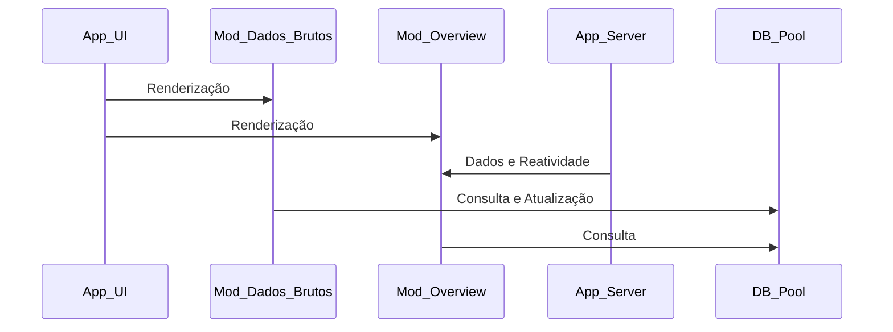

# GOVBR Dashboard - Aplicativo Shiny para Programas Sociais Brasileiros

Este projeto é uma aplicação web interativa desenvolvida com o framework `{golem}` em R, com o objetivo de promover transparência e facilitar o acesso aos dados de programas sociais brasileiros, como PROUNI, Bolsa Família e Luz Para Todos.

A aplicação permite explorar estatísticas, visualizar gráficos, consultar dados tabulares e interagir com filtros dinâmicos. Também oferece funcionalidades de edição de dados, glossário explicativo e formulário de contato.

Vale ressaltar que os dados são amostras extraídas de arquivos CSV publicados pelo [Portal de Dados Abertos](https://dados.gov.br/home).

---

# Estrutura do Projeto

O projeto segue a arquitetura modular do `{golem}`, com separação clara entre UI, Server e módulos funcionais.

## Inicialização da Aplicação

```r
renv::restore()
golem::run_dev()
```

## Principais Módulos

| Módulo | Descrição | Impacto |
|---------|------------|----------|
| **Mod_dados_brutos** | Renderiza as tabelas com os dados de cada programa social. Possui opções de filtragem, alteração e gravação no banco de dados. | Alto |
| **Mod_overview** | Renderiza gráficos e indicadores da aba Visão Geral, utilizando consultas e manipulação via `{dplyr}`. | Alto |
| **Mod_db_pool** | Gerencia as variáveis de conexão, abertura e fechamento do banco de dados utilizando `{pool}`. | Alto |
| **Mod_glossario** | Responsável pela estilização da aba Glossário, renderização dos comentários e organização dos temas. | Médio |
| **Mod_contato_mod** | Responsável pela estilização da aba Contato, formulário para visitantes e informações do projeto. | Médio |

## Funções Utilizadas

| Função | Descrição | Impacto |
|---------|------------|----------|
| **fct_get_bolsafm** | Armazena as consultas utilizadas pelos Value Boxes e gráficos do módulo `Mod_overview` para o programa Bolsa Família. | Alto |
| **fct_get_luzpt** | Armazena as consultas utilizadas pelos Value Boxes e gráficos do módulo `Mod_overview` para o programa Luz Para Todos. | Alto |

---

## Arquivos de Orquestração

| Arquivo | Descrição | Impacto |
|---------|------------|----------|
| **run_app** | Inicia a aplicação Shiny via `{golem}`. | Alto |
| **app_ui** | Define a interface visual da aplicação. | Alto |
| **app_server** | Define a lógica reativa e integração dos módulos. | Alto |

## Arquivos de Configuração

| Arquivo | Descrição | Impacto |
|---------|------------|----------|
| **golem-config** | Define parâmetros globais da aplicação. | Alto |
| **DESCRIPTION** | Define dependências e informações do projeto. | Alto |
| **NAMESPACE** | Controla quais funções são expostas externamente. | Alto |
| **renv.lock** | Garante a reprodutibilidade do ambiente através do `{renv}`. | Alto |

---

# Diagrama de Estrutura

## Sequence Diagram



---

# Funcionalidades

- **Visualização de dados** dos programas PROUNI, Bolsa Família e Luz Para Todos
- **Filtros interativos** por ano, estado (UF), universidade, raça, tipo de bolsa e modalidade de ensino
- **Gráficos dinâmicos** com distribuição demográfica e educacional
- **Tabelas interativas** com renderização via `{DT}`
- **Edição de dados** com seleção de ID, coluna e novo valor
- **Glossário técnico** explicando os termos utilizados
- **Formulário de contato** integrado à aplicação
- **Estilização personalizada** com CSS, HTML e JavaScript
- **Reprodutibilidade garantida** com `{renv}`

---

# Tecnologias Utilizadas

- R
- Shiny
- Framework `{golem}`
- `{DT}`
- `{ggplot2}`
- `{dplyr}`
- `{shinyWidgets}`
- `{renv}`
- Banco de Dados com operações CRUD
- HTML
- CSS
- JavaScript

---

# Contato

Este projeto faz parte do meu portfólio e busca abordar um tema relevante para a sociedade brasileira: políticas públicas e programas sociais.

Você pode entrar em contato diretamente pela aplicação ou pelos canais abaixo:

1. [LinkedIn](https://www.linkedin.com/in/ricardo-hernandes-05b93218a)
2. [GitHub](https://github.com/Ricardo-argus/GOVBR-Social-Programs-Shiny-Dashboard)

---

# Licença

Este projeto está licenciado sob a licença **MIT**.

---

# Contribuições

Contribuições são bem-vindas.

Caso tenha sugestões de melhorias, correções ou novas funcionalidades, fique à vontade para abrir uma Issue ou entrar em contato para discutirmos ideias e possíveis evoluções do projeto.
